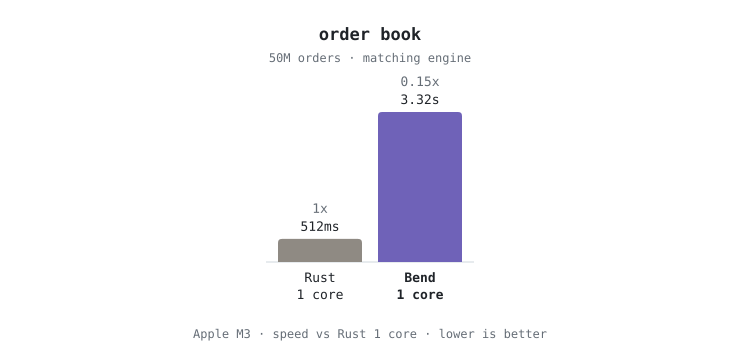
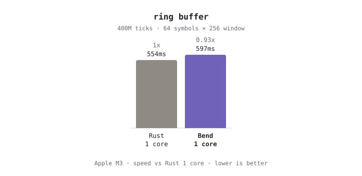
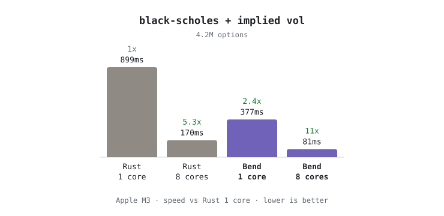
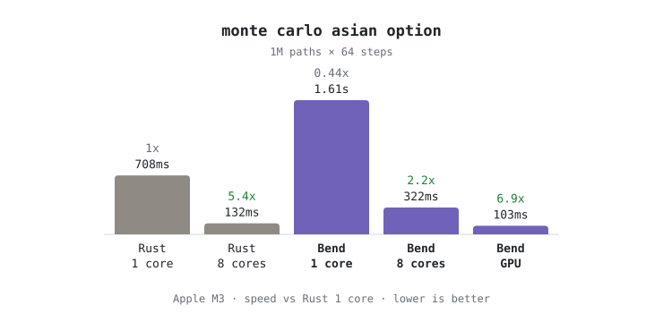

# Bend2 vs Rust on trading & quant kernels

[Bend 2](https://github.com/bendlang/bend) claims *"as fast as C on the CPU,
faster on 10000s of cores"* and *"blocks AI mistakes via proof"* (`LAWS.bend`).
This repo tests both claims on four kernels that show up in real trading
systems: the question is whether a proof-checked functional language can
compete with Rust on the code trading firms actually write. Each kernel is
implemented twice, in Rust and in Bend, against the same exact specification,
and a timing only counts if both languages print the same checksum.

## TL;DR

| Kernel | What it is | Bend vs Rust, 1 core | 8 cores |
|---|---|---|---|
| `orderbook` | L2 price-level book + matching engine, 50M orders | **6.5× slower** | (sequential) |
| `ringbuf` | 64-symbol × 256-tick ring buffer, O(1) rolling sum/sumsq + signal, 400M ticks | **1.08× slower** (≈ parity) | (sequential) |
| `blackscholes` | Black-Scholes price + 8-step Newton implied vol, 4M options | **2.4× faster** ⚠️ see below | 2.1× faster |
| `montecarlo` | Asian option, 64-step GBM paths, 1M paths | **2.3× slower** | 2.4× slower |
| `montecarlo` on the **GPU** (`tree!`) | same kernel, Apple M3 Metal | — | 1.3× faster than 8-core Rust at 1M paths, ≈4× at 4M |

- **Flat numeric loops over arrays** (ring buffer, float math): Bend is at
  parity with Rust, which is impressive for a pure, affine, proof-checked
  functional language.
- **Branchy, stateful code** (the order book, the core of any trading system): 6.5×
  slower. Every `if` becomes a helper function and every loop threads a
  record of state.
- **Parallelism** is trivial to express (`a b = f(x) g(y)`) and scales ~5×
  on 8 cores, in line with Rust's `std::thread`, but it does not close a
  single-core gap.
- **GPU**: one character (`tree(…)` → `tree!(…)`) moves the Monte Carlo
  pricer onto the M3's GPU. That is Bend's real differentiator.
- **For trading systems**: no 64-bit integers, no signed integers, no `if`,
  no mutual recursion. A research language, not something for a
  latency-critical path today. See [Verdict](#verdict-for-trading-systems).

## Methodology

- **One spec, two implementations.** `specs/` holds exact pseudocode,
  including the order of floating-point operations, so both languages round
  identically.
- **No I/O in the timed region.** Inputs are generated inside the kernel from a
  shared deterministic RNG (`bend/common.bend`, `rust/src/lib.rs`).
- **Correctness gates timing.** Every run prints a checksum; integer kernels
  must match exactly, float kernels within 1e-4 relative (in practice they
  match bit for bit, across languages and thread counts).
- **Robust timing.** Median of 5 runs after a warm-up, sizes chosen so runs
  take tens of milliseconds to seconds. `python3 bench/run.py` rebuilds
  everything, checks every checksum and regenerates `results/`.
- **Idiomatic, not tuned.** Straightforward code in both languages: no SIMD,
  no `unsafe`, no hand-optimisation.

## Results

<picture>
  <source media="(prefers-color-scheme: dark)" srcset="media/orderbook_dark.svg">
  
</picture>

<picture>
  <source media="(prefers-color-scheme: dark)" srcset="media/ringbuf_dark.svg">
  
</picture>

<picture>
  <source media="(prefers-color-scheme: dark)" srcset="media/blackscholes_dark.svg">
  
</picture>

<picture>
  <source media="(prefers-color-scheme: dark)" srcset="media/montecarlo_dark.svg">
  
</picture>

Apple M3 (8 cores), macOS, bend 2.0.24 (emits C, compiled by clang 21 `-O3`),
rustc 1.91.1 (`-C target-cpu=native`, LTO fat, codegen-units=1). In-program
kernel time, median of 5 runs after 1 warm-up, checksums verified on every
run.

| Benchmark | N | Rust 1T (ms) | Bend 1T (ms) | Bend/Rust 1T | Rust 8T (ms) | Bend 8T (ms) | Bend/Rust 8T | Checksums |
|---|---:|---:|---:|---:|---:|---:|---:|---|
| orderbook | 1,000,000 | 10 | 66 | 6.60× | — | — | — | match |
| orderbook | 10,000,000 | 103 | 662 | 6.43× | — | — | — | match |
| orderbook | 50,000,000 | 512 | 3324 | 6.49× | — | — | — | match |
| ringbuf | 10,000,000 | 13 | 15 | 1.15× | — | — | — | match |
| ringbuf | 100,000,000 | 138 | 149 | 1.08× | — | — | — | match |
| ringbuf | 400,000,000 | 554 | 597 | 1.08× | — | — | — | match |
| blackscholes | 262,144 | 59 | 24 | 0.41× | 11 | 6 | 0.55× | match |
| blackscholes | 1,048,576 | 223 | 94 | 0.42× | 42 | 19 | 0.45× | match |
| blackscholes | 4,194,304 | 899 | 377 | 0.42× | 170 | 81 | 0.48× | match |
| montecarlo | 65,536 | 45 | 103 | 2.29× | 9 | 23 | 2.56× | match |
| montecarlo | 262,144 | 175 | 407 | 2.33× | 36 | 78 | 2.17× | match |
| montecarlo | 1,048,576 | 708 | 1611 | 2.28× | 132 | 322 | 2.44× | match |

(Bend/Rust < 1 means Bend is faster.)

**GPU** (`bin/montecarlo_gpu_bend`): 103 ms at 1M paths (median of 7 runs)
and 125–150 ms at 4M paths, against 540–600 ms for Rust on 8 threads at 4M.
There is a fixed ~100 ms cost per GPU launch, so the GPU only pays off from
around 1M paths. The GPU result differs from the CPU one by 3e-6 relative
(Metal uses `fast::cos` and its own `exp`/`log`), within tolerance. Rust has
no GPU variant: matching it would mean hand-writing Metal or wgpu kernels,
which is exactly the work Bend removes.

## The kernels

The exact pseudocode for each is in `specs/`.

1. **`orderbook`**: a 1024-tick L2 book of aggregated quantity per price
   level (no per-order FIFO queues) with best bid/ask tracking, limit orders
   that cross the spread and sweep levels, market orders, and cancels with
   best-price rescans. Integer-only and
   sequential. This is the matching-engine / book-building hot path.
2. **`ringbuf`**: a preallocated 2-D circular buffer (64 symbols × 256 ticks)
   with O(1) incremental rolling sum and sum of squares, and a fixed-point
   "value > 1.25 × rolling mean" signal. This is how rolling features are
   really kept: no allocation, integer math.
3. **`blackscholes`**: price a European call, then recover its implied vol
   with 8 Newton steps (A&S normal CDF, f32), as an options market maker does
   continuously across chains. A fixed binary reduction tree keeps the f32 sum
   identical for any thread count.
4. **`montecarlo`**: an arithmetic Asian call priced over 64-step GBM paths
   with Box–Muller normals. Path-dependent exotics have no closed form, so
   desks price them by Monte Carlo. Embarrassingly parallel, which is Bend's
   best case.

## Analysis

**Order book (6.5× slower).** The Bend version is 417 lines against 149 for
Rust. With no `if`, every branch becomes a helper def that `match`es a
`Bool`. With no mutual recursion, every loop is a single self-recursive def
over a state record, and `while` loops (matching sweeps, best-price rescans)
become `Nat`-fuelled recursion. The compiler handles this well: records are
flattened into register arguments, loops become native tail loops, and an
array access is a mask plus a load. The remaining gap most likely comes
from the runtime's calling convention. Multi-value returns go through an out-array
between dozens of small compiled loop functions, and the whole kernel inlines
into one state machine, so a profiler can't attribute the gap more precisely.

**Ring buffer (parity).** Bend's `Array` is *typed* as a binary tree, but the
native runtime stores `Array<U32>` as a flat buffer with O(1) get and set, so
a tight integer loop over arrays compiles to roughly what Rust does.

**Black-Scholes (Bend 2.4× faster): verified, not fully explained.** This
result was checked rather than taken at face value:

- The checksums are bit-identical (Rust, Bend 1T, Bend 8T) and agree with an
  independent float64 Python reference to 2e-7.
- Counting libm calls in Bend's emitted C gives exactly the spec's 35 `exp`
  and 17 `log` per option, so no work is skipped.
- Bend's emitted C, compiled by hand with plain `clang -O3`, reproduces the
  speed (413 ms at 4M). A hand-written C version of the same spec runs at
  Rust speed (~900 ms), whether it uses `expf`, double `exp` (1160 ms), or
  loop invariants hoisted by hand (905 ms).
- A sampling profile shows Bend spending ~5× fewer samples in its own
  arithmetic, and fewer in libm, than Rust. The exact codegen reason is not
  isolated. Read this row as "Bend's C backend did very well on this kernel",
  not as a general claim that Bend beats Rust at float math.

**Monte Carlo (2.3× slower on 1 and 8 cores).** It has the same shape as
Black-Scholes (pure f32 math, a fork tree, leaf loops), with a 64-step inner
loop per path and 4 transcendental calls per step. Scaling is healthy in both
languages (Bend 5.0×, Rust 5.4× on 8 cores), so the single-core gap carries
over.

**Parallelism.** Writing `a b = tree(lo, half) tree(lo + half, half)` is all
it takes, and the runtime's fork-join scheduler scaled as well as explicit
Rust threads.

### Why the Bend README shows Bend beating C

Bend's own pinned results (`bench/runtime/_pin_/apple_m4_max.txt` in the Bend
repo) compare against **single-threaded** C. Their C baselines say so in the
source ("Single-threaded, 1-to-1 with the Bend program"). On one core, Bend
is slower than C on 15 of their 16 benchmarks, with a median around 1.2×
slower and outliers at 2.1× (lexer) and 4.4× (hashmap). The only single-core
win is `tree-matmul`. "Faster than C" in their charts means Bend on 16 cores
or the GPU against C on one core.

This repo finds the same pattern: parity on flat numeric loops, several times
slower on branchy, stateful code, and large wins only from parallel hardware
that single-threaded C doesn't use. The one difference is that Rust here also
gets 8 threads.

## Verdict for trading systems

Bend could fit offline or overnight pricing and risk (Monte Carlo, greeks
across books), research backtests, and anything embarrassingly parallel you
would otherwise hand-port to CUDA or Metal. It doesn't fit, yet:

- **No 64-bit or signed integers.** Prices in ticks × quantities overflow u32
  quickly, and nanosecond timestamps don't fit. Every kernel here had to be
  designed around wrapping u32/f32. This alone rules it out for production
  order handling.
- **The latency path.** The order book, the part latency-sensitive trading cares most about, is
  6.5× slower, and a runtime with its own event loop, scheduler and heap is
  not something you want on a tick-to-trade path.
- **Ergonomics.** No `if`, no mutual recursion, destructuring only on
  parameters, affine variables. See `docs/BEND_NOTES.md` for every trap.

## LAWS.bend: does "proof blocks mistakes" hold?

`laws/` contains a proof-friendly model of the matching engine's sweep: the
opposite side of the book is a list of resting quantities, and an aggressive
order sweeps it. Four laws are stated and proven
(`~/.bend/bin/bend laws/PROOF.bend` → `All terms check.`):

| Law | Meaning |
|---|---|
| `take_le_qty` | a fill never takes more than the order wants |
| `take_le_level` | a fill never takes more than the level holds (no negative liquidity) |
| `sweep_conserves_order` | filled + unfilled remainder == submitted quantity |
| `sweep_conserves_book` | filled + resting volume after == resting volume before (matching never creates or destroys liquidity) |

**It works as advertised on what it covers.** Injecting a bug (reporting the
level's quantity as filled instead of the amount taken) makes `PROOF.bend`
fail and print the mismatching terms. The proofs needed hand-written `Nat`
lemmas (associativity, left-commutativity, `min`/`sub` identities, in
`laws/lemmas.bend`), because Base ships almost none. Checking is instant.

**Caveats:**

- The laws are about a **`Nat` model**, not the benchmarked `U32` code.
  Proving things about `U32` means reasoning about 32-bit words bit by bit,
  and `F32` operations are opaque primitives, so **nothing can be proven
  about the float kernels at all** (Black-Scholes, Monte Carlo).
- A law only blocks the mistakes it states. The benchmark code itself is
  validated by cross-language checksums.
- The proofs are not free: 4 laws needed ~170 lines of proofs and
  supporting lemmas.

## Build and run

```sh
curl -fsSL https://bend-lang.com/install.sh | sh      # installs ~/.bend/bin/bend
export PATH="$HOME/.bend/bin:$PATH"                  # the installer doesn't
./build.sh                                           # → bin/<name>_{rust,bend}
python3 bench/run.py                                 # verify checksums + time everything (~3 min)

bin/orderbook_rust 10000000                          # prints checksum + kernel_ms
bin/orderbook_bend 10000000 --threads 1
bin/montecarlo_rust 1048576 8                        # Rust: 2nd arg = threads
bin/montecarlo_bend 1048576 --threads 8              # Bend: runtime flag
bin/montecarlo_gpu_bend 1048576                      # GPU (Metal / CUDA)

~/.bend/bin/bend laws/PROOF.bend                     # check the laws
```

Layout: `specs/` exact specifications · `bend/`, `rust/src/bin/`
implementations · `bend/common.bend`, `rust/src/lib.rs` shared RNG and CLI
helpers · `laws/` laws and proofs · `results/` raw measurements ·
`docs/BEND_NOTES.md` Bend2 idioms and traps.

## Caveats

- One machine (Apple M3) and no CUDA GPU. Bend's headline GPU numbers are
  for NVIDIA.
- The order book is an aggregated L2 book. A production L3 book with
  per-order queues (price-time priority) would stress allocation and pointer
  chasing more, which is where Bend was weakest here.
- The timer has 1 ms resolution. Single-core rows are ≥ 10 ms; the smallest
  8-thread rows (6–11 ms) are noisier, so use the larger sizes for
  conclusions.
- Both languages use deliberately straightforward implementations (no SIMD,
  no unsafe, no hand-tuning). This compares what you get from a reasonable
  first implementation, not from expert optimisation.
- Bend forced u32/f32-only designs. Production trading code in Rust would use i64/f64, which
  changes nothing about Rust's speed but everything about Bend's
  applicability.

## License

MIT, see [LICENSE](LICENSE).
